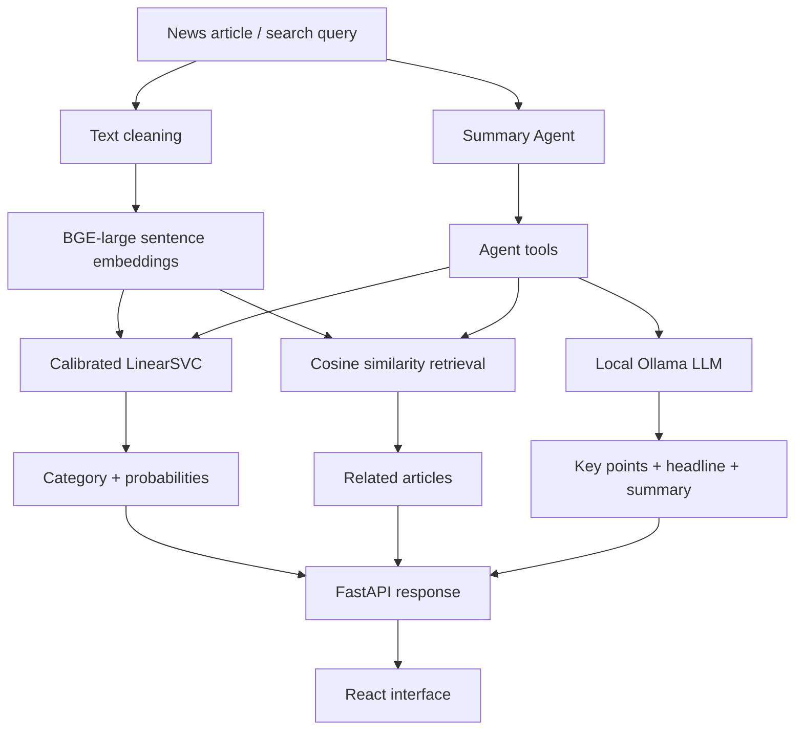

# News Intelligence

**An AI-powered news analysis system** that classifies articles, retrieves semantically related stories, searches a news corpus, and generates fact-aware summaries through a local LLM agent.

[](https://www.python.org/)
[](https://fastapi.tiangolo.com/)
[](https://react.dev/)
[](https://www.typescriptlang.org/)
[](#)

---

## Overview

News Intelligence combines **supervised text classification**, **dense semantic retrieval**, and **LLM-based agentic summarization** in one application.

Given a news article, the system can:

- Predict its topic across **14 news categories**, with calibrated class probabilities and a confidence indicator.
- Retrieve semantically similar articles from an indexed corpus using cosine similarity.
- Run classification and retrieval together through a single analysis request and a shared embedding.
- Search the corpus using a natural-language query, optionally filtered by category.
- Generate a headline, key points, and a length-controlled summary using a tool-using agent backed by a local Ollama model.

The core ML pipeline does not rely on a generative model to classify articles. It uses BGE sentence embeddings and a calibrated LinearSVC classifier. The LLM is a separate component used for summarization.

## AI architecture



The classifier, retrieval engine, and summary agent are separate services inside the backend. The React application consumes them through a typed API client.

For implementation details, see [Architecture](docs/ARCHITECTURE.md) and [Model Card](docs/MODEL_CARD.md).

## Technical highlights

### 1. Embedding-based news classification

- **Embedding model:** `BAAI/bge-large-en-v1.5` (1,024-dimensional vectors).
- **Classifier:** `CalibratedClassifierCV(LinearSVC)`, with `class_weight="balanced"`, sigmoid calibration, and 3-fold calibration CV.
- **Output:** top-k category predictions with probabilities.
- **Confidence handling:** the API marks a prediction as confident when its top probability is at least `0.50`; this is a configurable threshold, not a guarantee of correctness.
- **Input handling:** shared text cleaning between training and inference; minimum input length is 20 words, with a reliability warning for articles shorter than the recommended 200 words.

The production classifier was selected after comparing several approaches in the accompanying model-development work. The notebook comparison reported a **macro F1 of 0.792 on validation** and **0.797 on the held-out test set**; 5-fold CV macro F1 was **0.793 ± 0.008**. These are experiment results, not a promise that every retraining run will reproduce the same scores. The training script writes fresh evaluation metrics to the artifact bundle.

### 2. Semantic retrieval

The same BGE embedding space powers related-article retrieval and search:

- Corpus vectors are L2-normalized and stored as a dense NumPy matrix.
- Cosine similarity is computed efficiently as a matrix-vector dot product.
- Classification and related-article retrieval reuse the same article embedding in `/analyze`.
- Short search queries use BGE's query instruction, while article embeddings follow the exact preprocessing used during classifier training.
- Retrieval can be filtered by predicted category and/or a minimum similarity threshold.

This is **semantic retrieval**, not keyword matching or a generative answer.

### 3. Tool-using summarization agent

The summarization component is an agent loop, not a single prompt that returns a block of text.

It has tools for:

| Tool | Role | Responsibility |
|---|---|---|
| `get_article_overview` | LOOK | Inspect word count and article preview |
| `classify_article` | LOOK | Reuse the trained classifier |
| `find_related_articles` | LOOK | Retrieve related corpus items |
| `extract_key_points` | ACT | Extract structured, source-grounded facts |
| `write_summary` | ACT | Produce a headline and requested summary length |
| `save_summary` | ACT | Mark a completed result |

The LLM chooses the tool sequence, while backend code enforces tool validation, per-request state, maximum steps, and a token budget. Structured JSON output is used for key-point extraction and summary generation. The prompts explicitly preserve names, figures, units, time periods, attribution, and uncertainty, and instruct the model not to invent unsupported causal claims.

If a model does not support tool calling, the agent uses a direct structured-output fallback with the same fact-first sequence. The API returns a trace for inspection; the frontend presents the result with a simple loading state rather than exposing internal agent steps.

**Default LLM:** `qwen3:0.6b` through local Ollama.  
**Alternative tested in the project:** `gemma3:1b`.

No hosted LLM API key is required for the default setup.

## Technology stack

| Layer | Technologies |
|---|---|
| ML / NLP | Python, Sentence Transformers, BGE-large, scikit-learn, NumPy, pandas |
| Classification | LinearSVC + sigmoid probability calibration |
| Retrieval | Dense vector index, cosine similarity |
| Summarization | Tool-using LLM agent, Ollama, structured JSON output |
| Backend | FastAPI, Pydantic, Uvicorn |
| Frontend | React 19, TypeScript, Vite, Tailwind CSS v4 |

## Repository structure

```text
.
├── backend/
│   ├── app/
│   │   ├── agent.py          # Tool-using summary agent and fallback
│   │   ├── config.py         # Runtime configuration
│   │   ├── embedder.py       # BGE embedding adapter
│   │   ├── engine.py         # Classification and retrieval inference
│   │   ├── local_llm.py      # Ollama-compatible chat client
│   │   ├── main.py           # FastAPI application and endpoints
│   │   ├── schemas.py        # Request / response validation
│   │   └── text.py           # Shared text cleaning and category mapping
│   ├── training/
│   │   └── train.py          # Evaluation, classifier training, artifact export
│   ├── tests/                # API, agent, and local-LLM tests
│   └── artifacts/             # Generated model and corpus files (not committed)
├── docs/
│   ├── ARCHITECTURE.md
│   └── MODEL_CARD.md
└── frontend/
    ├── public/images/         # Category artwork
    └── src/
        ├── api.ts             # Typed API client
        ├── hooks.ts           # Backend status and UI hooks
        └── components/        # Article analysis, summary, search, and layout
```

## Getting started

### Prerequisites

- Python 3.10 or newer.
- Node.js 20 or newer and npm.
- [Ollama](https://ollama.com/) for local summarization.
- The cleaned training CSV and its matching precomputed BGE embeddings if you need to regenerate the model artifacts.

### 1. Clone the repository

```bash
git clone https://github.com/reham0138/news-classification-recommendation-summary.git
cd news-classification-recommendation-summary
```

### 2. Prepare the backend environment

**Windows PowerShell:**

```powershell
cd backend
python -m venv .venv
.\.venv\Scripts\Activate.ps1
pip install -r requirements-dev.txt
```

**macOS / Linux:**

```bash
cd backend
python -m venv .venv
source .venv/bin/activate
pip install -r requirements-dev.txt
```

### 3. Prepare model artifacts

The generated model artifacts are intentionally excluded from Git. The training script expects:

- A cleaned CSV containing `title`, `content`, and `category` columns.
- A matching `.npy` file containing BGE embeddings in the **same row order** as the CSV.

The embedding file must be generated from that exact dataset with `BAAI/bge-large-en-v1.5`. The training script checks row alignment and normalizes vectors when needed.

From the `backend/` directory:

```bash
python -m training.train --data PATH/TO/final_data_V2.csv --embeddings PATH/TO/final_data_embeddings.npy
```

This creates `backend/artifacts/` containing:

- `model_bundle.joblib` — calibrated classifier, classes, model metadata, and metrics.
- `corpus_embeddings.npy` — normalized vectors used for retrieval.
- `corpus.csv` — article metadata aligned with the vector index.
- `metrics.json` — evaluation report.

If you already have a compatible artifact bundle, place it in `backend/artifacts/` and skip retraining. The embedding model name used by the API must match the one recorded in the bundle.

### 4. Configure and start Ollama

In a separate terminal:

```bash
ollama pull qwen3:0.6b
ollama serve
```

If Ollama is already running as a background service, the `ollama serve` command is not needed.

Optional alternative:

```bash
ollama pull gemma3:1b
```

### 5. Start the backend

From `backend/`, with the virtual environment activated:

```bash
uvicorn app.main:app --reload --port 8000
```

The first startup downloads/loads `BAAI/bge-large-en-v1.5` if it is not cached. Once ready:

- API health: http://localhost:8000/health
- Interactive API docs: http://localhost:8000/docs

### 6. Start the frontend

Open a new terminal at the repository root:

```bash
cd frontend
npm install
npm run dev
```

Open http://localhost:5173.

To point the frontend at another backend URL, copy `frontend/.env.example` to `.env` and set:

```env
VITE_API_URL=http://localhost:8000
```

Only the backend should contain model/provider configuration. Do not put private API keys in frontend environment variables.

## API reference

Base path: `/api/v1`

| Method | Endpoint | Purpose |
|---|---|---|
| `POST` | `/classify` | Return top-k category predictions and confidence |
| `POST` | `/analyze` | Classify an article and retrieve similar articles in one embedding pass |
| `POST` | `/search` | Search the corpus using a semantic query |
| `POST` | `/summarize` | Run the LLM summary agent |
| `GET` | `/meta` | Return categories, model metadata, corpus size, and metrics |
| `GET` | `/health` | Report whether the backend engine is ready |

Open `/docs` while the backend is running for the complete request and response schemas.

## Frontend

The frontend is a lightweight React single-page interface. Users paste an article once, run classification and related-story analysis, request a summary, or search the indexed corpus. It includes category-aware article cards, probability indicators, dark mode, and responsive layouts. The AI logic remains in the Python backend; the frontend is responsible for interaction and presentation.

## Tests

From `backend/` with the development dependencies installed:

```bash
pytest
```

The tests use fake embeddings and scripted LLM/Ollama responses. They cover API contracts, validation, classification/retrieval behavior, agent tool execution, fallback paths, token/step limits, and local-client integration. They **do not measure real LLM summary quality** or replace an end-to-end test with the trained artifacts and actual Ollama models.

Frontend checks:

```bash
cd frontend
npm run typecheck
npm run build
```

## Limitations

- Classification quality depends on the training corpus, its category balance, and how representative it is of new articles.
- The confidence flag is based on a configurable probability threshold; it is not a calibrated guarantee that a prediction is correct in every domain.
- Similarity scores measure embedding-space proximity, not factual agreement or source reliability.
- Summary quality depends on the selected local LLM. Always verify important names, numbers, dates, and claims against the original article.
- The default BGE model is relatively large; the first startup requires a model download and sufficient memory.
- The application currently uses a local corpus index. It does not continuously ingest live news.

## License

No license has been specified yet. Until one is added, the repository should not be assumed to grant permissions for reuse or redistribution.
