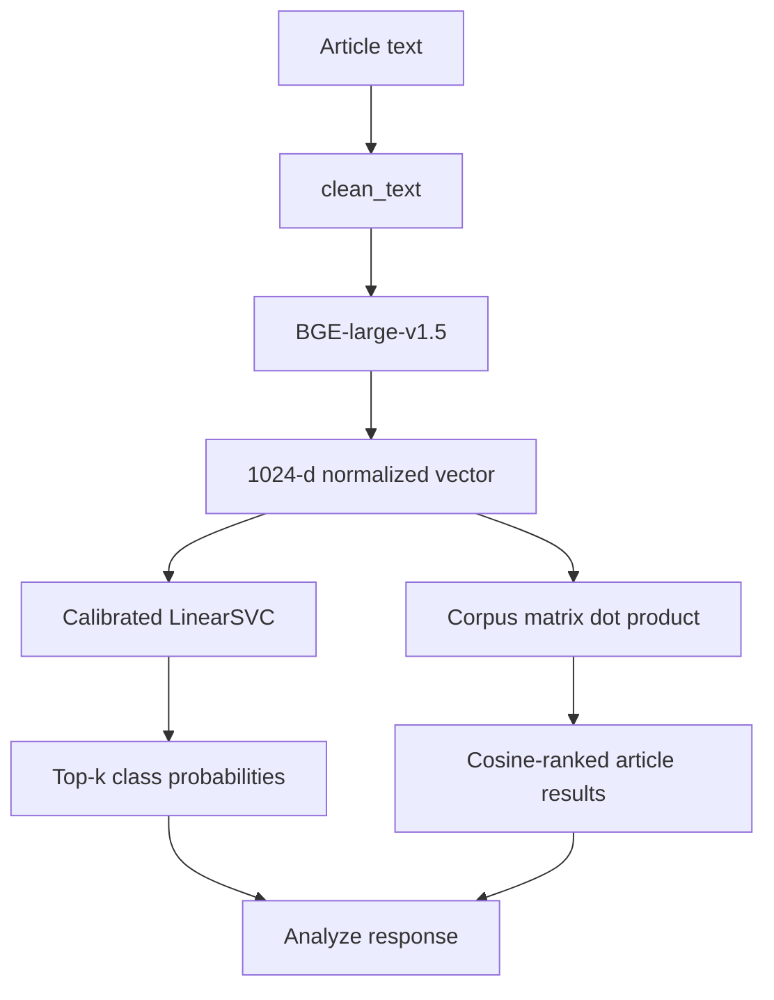

# System Architecture

This document describes the current implementation of News Intelligence.

## 1. Component boundaries

| Component | Location | Responsibility |
|---|---|---|
| Text utilities | `backend/app/text.py` | Shared HTML stripping, whitespace normalization, category normalization |
| Embedding adapter | `backend/app/embedder.py` | Load BGE once and return normalized float32 vectors |
| Inference engine | `backend/app/engine.py` | Load artifacts, classify, calculate similarity, query the corpus |
| Training pipeline | `backend/training/train.py` | Evaluate and fit the production classifier; export serving artifacts |
| Summary agent | `backend/app/agent.py` | Tool orchestration, structured extraction, summary generation, budgets and fallback |
| HTTP API | `backend/app/main.py` | FastAPI lifecycle, validation, CORS, dependency injection, endpoint contracts |
| Web client | `frontend/src/` | Typed HTTP client and user-facing workflow |

## 2. Classification and retrieval path

### Training

1. Load the cleaned CSV and its matching precomputed embedding matrix.
2. Validate required columns and ensure the CSV and embedding rows align.
3. Normalize category labels using the shared category map.
4. Split the data using stratified 70/15/15 train, validation, and test partitions with random seed 42.
5. Evaluate a `CalibratedClassifierCV` wrapping `LinearSVC(class_weight="balanced")` with sigmoid calibration and 3-fold calibration CV.
6. By default, refit the selected classifier on all available labeled embeddings.
7. Export the classifier bundle, normalized corpus embeddings, article metadata, and evaluation metrics.

The BGE encoder is not fine-tuned by this script. It consumes precomputed embeddings created from the same embedding model used at inference.

### Inference

The API loads the classifier and corpus index once during application startup. For an article request, the engine cleans and embeds the input once, then reuses that vector for both classification and retrieval. This avoids an unnecessary second encoder pass in `/analyze`.

All article and corpus vectors are L2-normalized. Therefore:

`cosine_similarity(a, b) = dot(a, b)`

The retrieval engine ranks corpus rows by this dot product and can apply category and minimum-similarity filters.

For short search queries, the engine prepends BGE's configured query instruction. Full article embeddings deliberately use no query prefix, matching the training embeddings.

## 3. Confidence and input validation

- Empty input is rejected by Pydantic.
- Article text is capped at 30,000 characters.
- Classification and analysis require at least 20 words.
- Inputs shorter than the recommended 200 words receive a warning because the training examples are longer articles.
- The API's confidence flag is true when the highest calibrated class probability is at least the configured threshold (default 0.50).

The confidence threshold is a product decision and should be re-evaluated when the dataset or deployment domain changes.

## 4. Summary agent

`SummaryAgent` creates a fresh run-state object for each request. This isolates the article, classification result, extracted facts, generated summary, token count, and trace from concurrent requests.

The agent exposes six tools:

- LOOK: article overview, classifier prediction, and related-article retrieval.
- ACT: fact extraction, summary writing, and final save.

The agent controls the sequence; backend methods validate arguments and perform the actual operations. The LLM receives a short article preview in the orchestration loop. Tools that need the full article receive it as quoted data, with an explicit instruction to ignore embedded instructions.

Fact extraction and summary generation use structured JSON schemas. The writing step receives the extracted points and checks them against the original article. The run stops when the summary is saved, the step limit is reached, or the token budget is exhausted.

### Tool-calling fallback

Some local models do not implement function/tool calling. When the agent detects a provider response that does not support tools (or receives a plain response rather than tool calls), it switches to a deterministic backend-controlled sequence:

`extract_key_points → write_summary → save_summary`

This preserves the structured-output path without requiring tool-calling support from the model.

## 5. API and frontend boundary

The FastAPI app exposes versioned endpoints under `/api/v1`. Pydantic schemas define and validate request/response shapes. The React client uses a single typed API module, while UI components manage the article workspace, loading/error states, results, and search interaction.

The frontend does not run the classifier, embedding model, or LLM. It only sends requests to the backend and renders returned data.

## 6. Runtime dependencies

- BGE-large is loaded once by the backend and may be downloaded on first startup if not cached.
- Ollama serves the local summarization model at its OpenAI-compatible local endpoint (default `http://localhost:11434/v1`).
- Classifier and retrieval endpoints can operate independently of the LLM summarization component.
- The model bundle, corpus vectors, and corpus metadata must be generated before the production inference engine can start.
